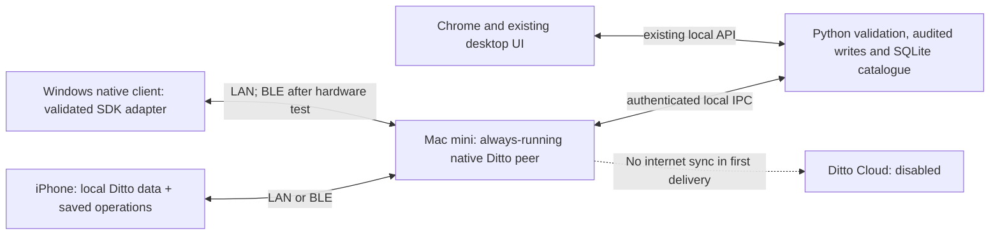

# Ditto local synchronization: feasibility and phased implementation plan

Project: **BonaManĝo** (`bona_manĝo`)  
Researched: **12 November 2026**  
Status: **14 November 2026: vendor confirms paid production licensing is required. The zero-cost commercial gate failed. Ditto implementation is on hold; no SDK or migration is installed.**

See [Phase 0 findings](DITTO_PHASE_0_FINDINGS.md) and the
[original inquiry draft](DITTO_PHASE_0_VENDOR_INQUIRY.md) for research context.
The [vendor response assessment](DITTO_VENDOR_RESPONSE.md) supersedes the earlier
uncertainty about free offline production rights.

Provider-independent preparation is recorded in [Sync preparation](../sync/SYNC_PREPARATION.md).
It does not satisfy the Ditto licence or radio gates. Android minimum/target
policy is now API 31/36; hardware qualification remains outstanding.

## 1. Recommendation and commercial gate

The requested LAN and nearby Bluetooth synchronization is **technically feasible
for native apps**, subject to a physical-device proof of concept. However, the
vendor now confirms that **offline-only production use is not free**. Retain
the working sync implementation. The phases below are conditional plans only;
proceeding with Ditto requires an explicit paid-licensing decision and a licence.

Ditto's public pricing lists Free cloud service allowances of 10 concurrent
cloud device connections, 2 GB storage and 5 GB transfer, with a Ditto-hosted
deployment model. Self-managed deployment appears under Enterprise. These are
cloud-plan allowances, not proof of an entitlement to free production offline
mesh operation or a free self-hosted Ditto Server.
[Ditto pricing](https://www.ditto.com/pricing)

More decisively, Ditto says Offline Shared Key requires an offline-only licence
token, generally issued to customers with a production agreement. The same
shared credential gives every peer full read/write access; individual device
revocation is unavailable without rotating the group key. This may be acceptable
for a small, trusted private group, but it is not per-device owner authorization.
[Authentication and Authorization](https://docs.ditto.live/key-concepts/authentication-and-authorization)

**Decision:** proceed with evaluation, not an unconditional Free-tier migration.
If Ditto will not provide the required production entitlement at zero cost,
record the answer and stop this migration under the current budget. Retain the
existing HTTP/SQLite sync rather than quietly introduce a subscription.

## 2. What “server on the Mac mini” should mean

Recommend a **BonaManĝo host application running a native Ditto SDK peer** on
the Mac mini. It keeps a persistent copy and acts as our application-level
coordinator. It is not Ditto's separately licensed full server product, formerly
called Big Peer. Do not start by installing a cloud/server stack in Docker.

Ditto is embedded local storage plus replication, not a Bluetooth adapter for
our existing HTTP endpoints. Each native participating device needs a Ditto
integration and its own store. LAN and BLE are SDK transports; the Python server
cannot gain BLE sync merely by changing a URL.
[Mesh networking](https://docs.ditto.live/key-concepts/mesh-networking.md)

Proposed first-delivery topology:

Retain one owner/administrator, David. Trusted invited devices may save edits;
that does not give them administration of the Mac, Apple account or Ditto account.
The host validates and acknowledges edits; devices keep offline saves locally
until they receive that acknowledgement. A disconnected host therefore means
“saved locally / waiting for Mac”, even if another nearby phone received a copy.

## 3. Platform feasibility

| Platform | LAN / nearby capability | First-delivery treatment |
|---|---|---|
| iPhone/iPad native app | Flutter SDK offers native peer transports; BLE needs real hardware | Primary client; foreground reliability required |
| Mac mini | Swift SDK supports macOS and lists Mac mini; BLE/LAN capability must be proven on this machine | Resident native host; prefer Swift SDK for the radio-facing helper |
| macOS Flutter UI | Current compatibility docs list macOS ARM64, but published package README still describes desktop support as planned | Keep local HTTP UI initially; test pinned Flutter bindings before selecting a direct SDK adapter |
| Windows native app | Current Flutter compatibility matrix lists Windows x64 with LAN/BLE transports | Verify SDK binary, OS, Bluetooth adapter and permissions; retain existing HTTP mode until qualified |
| Chrome/web | Ditto browser SDK has WebSockets, not native LAN/BLE mesh | Keep the existing local API/gateway route; no browser Bluetooth promise |
| iOS simulator | No BLE in the SDK compatibility matrix | Use for logic, persistence and LAN tests only |

The inconsistent package README and current compatibility page are an explicit
version-validation risk, not a reason to assume desktop support is absent or
fully production-ready. Pin versions after compiling the actual adapters.
[Flutter compatibility](https://docs.ditto.live/sdk/latest/compatibility/flutter.md),
[published Flutter package](https://pub.dev/packages/ditto_live),
[Swift compatibility](https://docs.ditto.live/sdk/latest/compatibility/swift)

A browser cannot become a mesh participant by enabling Web Bluetooth. A local
API gateway is our application bridge, not an implementation of the Ditto wire
protocol. Chrome on the Mac can continue through localhost. Serving remote LAN
browsers needs a separately tested authenticated gateway/origin configuration;
do not disable CORS or publish an unauthenticated listener.
[Browser transport restriction](https://docs.ditto.live/key-concepts/mesh-networking.md#transports)

Keep the host awake, with Bluetooth enabled and permissions granted. A Mac
LaunchAgent/menu-bar application in the logged-in user session is the proposed
operating model; an unattended, logged-out BLE daemon is not assumed to work.
No guaranteed range or throughput is promised. Test the actual room and hardware.

## 4. Scope and invariants

**First delivery includes:** packaged initial data, offline reads and saved edits,
LAN synchronization, nearby BLE synchronization without shared Wi-Fi, safe
conflict handling, a persistent Mac host, restart recovery and rollback.
Mac/iOS are the initial acceptance pair; Windows must pass its own native gates
before being labelled supported. Chrome's existing local access remains usable.

**Excluded:** internet catalogue sync, a hosted Ditto Server, router port
forwarding, VPN/relay services, public discovery, multiple administrators and
unconditional background iOS synchronization. Future internet work is Phase 7.
Account creation, SDK downloads and obtaining a licence during setup are distinct
from transmitting restaurant data to the internet.

Preserve these behaviours throughout:

- Drafts stay in form controllers. Only Save, confirmed Delete, Add or a confirmed
  review action creates a durable operation. Cancel creates no operation.
- An open review/edit flow, including nested Edit details, keeps its displayed
  record stable. Incoming committed changes must not overwrite the form.
- All fields, addresses, ratings, review results, evidence, source links, notes,
  duplicate history, pending changes and conflict history survive migration.
- “Synced with Mac” requires a durable host acknowledgement; peer discovery or
  a local database commit alone is not success.
- Reopening an app never replaces pending work with the packaged starting data.

Ditto uses CRDTs for convergence. That does not automatically reproduce our
revision checks, review rules, audit history or the user's choice between two
conflicting edits. Those remain application responsibilities.
[Ditto document model](https://docs.ditto.live/key-concepts/document-model)

## 5. Proposed data and ownership design

For this migration, keep the audited Mac SQLite catalogue as the accepted-record
authority and use Ditto for durable operation/event replication. This limits
rewrites of the Python research/import tools. It is a design proposal, not a
requirement of Ditto. Native clients move to a repository adapter backed by local
Ditto data and a projection of accepted records plus their own pending operations.

Use stable catalogue/record IDs. Map existing integer restaurant IDs once; new
offline venues and operations get UUIDs, avoiding collisions between devices.
Suggested collections are:

| Collection | Contents |
|---|---|
| `catalogue_operations` | Immutable saved commands: operation ID, device ID, record ID, base revision, action, changed fields and dependencies |
| `catalogue_events` | Host-accepted record versions and tombstones, ordered by a host sequence; prior values retained for audit |
| `operation_receipts` | Durable accepted/rejected/conflict result referencing the original operation |
| `review_evidence` | Independently identified evidence/source items, linked to stable record IDs |
| `catalogue_metadata` | Schema version, migration epoch, host identity and bootstrap manifest |

Split the existing multi-megabyte JSON snapshot into bounded documents. Do not
replicate it as one mutable Ditto document or a single ever-growing history
array. Keep large evidence separately keyed so BLE can prioritize ordinary edits.
[Document sizing and modeling](https://docs.ditto.live/key-concepts/document-model)

The host must persist a receipt and its SQLite change/audit/publication-outbox
entry in the **same SQLite transaction**, then publish to Ditto asynchronously.
There is no assumed atomic transaction spanning SQLite and Ditto. Reprocessing
the same operation republishes its existing result rather than applying it twice.
A crash between database commit and publication is recovered by replaying the
host outbox. All owner/import/research and legacy HTTP writes must feed this
publication path too; no unobserved second writer is allowed.

Preserve optimistic concurrency initially: conflicting same-field or review
state changes remain available for explicit resolution. Represent deletion with
a tombstone; do not purge it while an offline device could resurrect the record.
Receipt validation must distinguish host-issued results from other peers. With
shared-key authentication, host-only writes are not enforced by that key: pin a
separate host signing public key and validate signed receipts/events, or obtain
an appropriately licensed per-device authorization solution. Reject invalid
signatures; do not treat a display-name string as host identity.

Local Ditto commit tracking can supplement progress reporting, but the UI must
still await the operation's host receipt and accepted event before clearing
“waiting for Mac”. A rejected operation is an issue, not a successfully synced
edit. [Commit tracking](https://docs.ditto.live/sdk/latest/sync/tracking-local-commits)

## 6. Phases, acceptance criteria and checkpoints

Each phase produces reviewable evidence before the next starts. Estimates should
follow the licence decision and radio spike; a fixed schedule now would conceal
the two largest unknowns.

### Phase 0 — Confirm licence, offline authentication and SDK versions

**Goal:** establish whether the requested zero-cost design is permitted and viable.

Tasks:

1. Obtain written/portal confirmation for private production/TestFlight use of
   native LAN/BLE mesh on Free, including the Mac host and intended device count.
2. Confirm an offline-only licence can be issued, its expiry/renewal procedure,
   whether devices ever require internet activation, and what happens on expiry.
   Do not assume that disabling cloud data transport disables online auth.
3. Confirm whether a persistent SDK host needs a separate entitlement; distinguish
   it from full self-managed Ditto Server licensing.
4. Select exact compatible Flutter and Swift SDK releases; record OS/architecture,
   current Flutter/Dart/Xcode versions, signing needs and native test support.
5. Verify offline credentials can be provisioned to a fresh phone with restaurant
   data traffic to all internet hosts disabled. Keep secrets out of Git and logs.

**Exit evidence:** licence/limits decision, version matrix, confirmed supported
identity configuration and a reproducible fresh-device offline enrollment result.

**Stop condition:** no free production entitlement, mandatory online dependency
that contradicts the agreed requirement, or no supported Mac BLE host. A cloud
Playground demonstration is not proof of this phase's acceptance. Online
bootstrap/renewal without catalogue upload could be evaluated as a separate
compromise only if David chooses it; it is not the offline-only target.

### Phase 1 — Isolated LAN and Bluetooth proof of concept

**Goal:** prove transports on the actual Mac mini and David's physical iPhone,
using fictional records and a separate test database/identity.

Tasks:

- Build the Mac native host and minimal Flutter iOS client; enable only approved
  local transports. Explicitly disable Ditto Server/cloud WebSocket destinations
  and any automatic cloud connection mode before starting real-data sync.
- Request SDK-required Bluetooth/local-network/Bonjour permissions, plus macOS
  sandbox network/Bluetooth access where applicable. Do not add multicast beta
  transports or unrelated location permissions without a demonstrated need.
- Test bidirectional LAN changes with internet access blocked.
- For **BLE-only proof**, disable LAN and AWDL/P2P Wi-Fi in the test configuration;
  leave Bluetooth available and confirm the active transport in diagnostics.
  Merely leaving the home Wi-Fi can still use AWDL and does not prove BLE.
- Test both starting without Wi-Fi and losing an established LAN connection.
  Verify re-discovery, interruption/resumption, radio toggles and permissions denied.
- Measure small edits and full initial synchronization separately; capture elapsed
  time, document count, host receipt and actual selected transport.

Ditto exposes independent transport controls. Its mesh documentation cautions
against assuming immediate new BLE fallback on LAN loss; redundant-connection
settings and SDK-version behaviour therefore need explicit tests.
[Transport controls](https://docs.ditto.live/sdk/latest/sync/customizing-transport-configurations.md),
[redundant Bluetooth](https://docs.ditto.live/sdk/latest/sync/managing-redundant-bluetooth-le-connections.md)

**Exit evidence:** real iPhone ↔ Mac LAN and BLE-only round trips, persistence
across restart, recorded latency and no restaurant-data connections to internet
endpoints. One iPhone plus the Mac is enough for this gate; a second iPhone is not
required. Do not claim phone-to-phone radio acceptance without that later test.

### Phase 2 — Repository boundary and safe migration

**Goal:** add a selectable Ditto backend without replacing working user data.

Tasks:

- Extract a catalogue/review repository interface and a small sync-status interface.
  Keep the current HTTP/SQLite implementation as the default rollback adapter.
- Add the Ditto adapter, bounded collections, schema version and ID mapping.
- Back up Mac SQLite and export every mobile outbox/conflict history before import.
  Inventory records, evidence and pending operations by count and content hash.
- Import the existing seed and mobile overlays once with a migration checkpoint;
  preserve original operation IDs and dependencies or maintain a durable mapping.
  Repeated/partially interrupted imports must be idempotent.
- Prevent the legacy sync engine and Ditto adapter from uploading the same device
  operation simultaneously. No uncontrolled dual-writing period.

**Exit evidence:** migration/restart tests and field-by-field reconciliation,
including Unicode names, ratings, archived/deleted records and unsent edits;
rollback reproduces both accepted data and outstanding local work.

### Phase 3 — Persistent Mac host and audited command processing

**Goal:** make the Mac mini a reliable coordinator independent of a visible UI.

Tasks:

- Implement a single-instance native host with persistent Ditto storage and the
  authenticated local IPC bridge to Python. Prefer Swift for the radio layer;
  the Python SDK is publicly described as preview, so do not assume a direct
  Python BLE implementation is equivalent.
- Add idempotent operation receipts and transactional publication recovery to
  the Python validation/audit layer. Include all edit/review/archive/delete/add
  and owner research/import paths.
- Package as a signed macOS user application/LaunchAgent with first-run permission
  prompts, start/stop controls, redacted logs and restart recovery. Specify that
  the logged-in Mac must remain awake; test locked-screen behaviour separately.
- Give Mac/Chrome local API users the same accepted records and audited mutations.
  Do not open an unauthenticated bridge listener to the LAN.

**Exit evidence:** kill/restart at each transaction/publication boundary without
lost or duplicate changes; owner edits reach the phone; phone edits reach SQLite;
Mac restart restores sync without manually reopening a catalogue window.
[Swift setup](https://docs.ditto.live/sdk/latest/install-guides/swift),
[Python SDK preview](https://pypi.org/project/dittolive-ditto/)

### Phase 4 — Production iOS flow and draft-safe synchronization

**Goal:** preserve the current compact UI and deliberate Save/review behaviour.

Tasks:

- Use the local repository for offline screens; submit only confirmed actions.
  Keep temporary form fields completely outside replicated collections.
- Defer visible record replacements while any edit/review flow is open. Incoming
  replication may continue safely into storage, but must not reset controllers.
  If an action depends on changed data, show a conflict after Save; preserve input.
- Add distinct states: saved locally, waiting for host, syncing over LAN/BLE,
  acknowledged by host, and conflict/error. “Sync now” and modal dismissal must
  use host acknowledgements, not merely an empty transport queue.
- Replace hand-entered long secrets with a reviewed QR/deep-link enrollment flow
  or secure paste fallback; validate host identity and keep credentials in Keychain.
  Plan shared-key rotation as whole-group re-enrollment, not per-device revocation.
- Keep the packaged starting catalogue and avoid overwriting initialized data.

**Exit evidence:** no network writes while typing; Cancel publishes nothing;
Save and review decisions persist offline and later converge; incoming edits never
interrupt nested Edit details; the sync modal closes only after real success.

Foreground sync is the first acceptance target. iOS may suspend/terminate apps;
Bluetooth background modes do not guarantee continuous execution. Add supported
background modes/state restoration only after device testing and an explicit
product requirement. [Apple background behaviour](https://developer.apple.com/library/archive/documentation/NetworkingInternetWeb/Conceptual/CoreBluetooth_concepts/CoreBluetoothBackgroundProcessingForIOSApps/PerformingTasksWhileYourAppIsInTheBackground.html)

### Phase 5 — Cross-platform integration and local-only acceptance

**Goal:** qualify the supported first release without weakening existing platforms.

Tasks:

- Prove native macOS/Windows SDK bindings and BLE hardware independently; retain
  HTTP/gateway mode where unqualified. Add a Windows-specific evidence checklist.
- Preserve Chrome through the host's application API. Remote LAN browser support,
  if required for release, gets explicit origin/authentication tests; it remains
  a gateway client, never a BLE peer.
- Retain all existing Python, widget, persistence and golden tests behind injected
  repositories. Add real Ditto local-store tests and multi-peer integration tests
  under a dedicated test identity; never test against the live catalogue.
- Extend the test runner with explicit Ditto-store, LAN and physical BLE test
  targets. An unavailable physical target reports **not run**, never a BLE pass.

Acceptance matrix:

| Scenario | Required evidence |
|---|---|
| Same LAN, WAN disconnected | Both-direction changes and host receipts |
| Different/no Wi-Fi, BLE-only | Physical iPhone/Mac run with non-BLE transports disabled |
| LAN lost mid-operation | Eventual receipt with one audit change, no duplicate operation |
| Host absent/asleep | Safe local save, accurate waiting status, later reconciliation |
| Competing edits / archive versus edit | Both inputs retained; explicit conflict resolution |
| Delete followed by stale offline reconnect | Tombstone prevents silent resurrection |
| App/host crash, disk full, malformed command | Recovery or retained retry/error; no silent loss |
| Permission denied / wrong key / expired licence | Clear error, local data remains readable |
| Form open during remote updates | Draft untouched; only confirmed values submitted |
| Clean catalogue | No repeated application-level saves/full snapshots; measure SDK discovery traffic separately |
| No internet data sync | Fresh start and reconnect with internet blocked; no public cloud peers or destinations |

Ditto necessarily performs discovery/connection maintenance. “No data changes”
means no repeated application writes or full catalogue uploads; it cannot mean
zero Bluetooth/LAN radio packets. Measure battery and idle traffic rather than
promise a silent mesh. Model-based tests can simulate a second writer, but a
future second physical phone is still needed to qualify phone-to-phone BLE and
three-peer relay behaviour. [Ditto testing guidance](https://docs.ditto.live/sdk/latest/deployment/testing.md)

**Exit evidence:** existing regression suite passes plus new adapter/store tests,
physical LAN/BLE checklist and platform-specific results. Publish only claims
supported by recorded hardware tests.

### Phase 6 — Controlled rollout, backup and rollback

**Goal:** enable local Ditto sync for the invited group without losing work.

Tasks:

- Release to the owner first, reconcile counts/hashes, then enroll invited phones.
  Keep an explicit feature flag and migration epoch; record which backend each
  device uses. Do not delete legacy queues/databases during initial rollout.
- Establish consistent SQLite and Ditto export backups, host signing-key recovery,
  licence expiry reminders and a verified restore procedure.
- Before fallback to HTTP, export/translate every unacknowledged Ditto command and
  reconcile accepted receipts with the Mac. Restoring an old snapshot alone is
  not a valid rollback because it could discard newer offline work.
- Update running/TestFlight documentation and phone instructions. Retire legacy
  device sync only after all enrolled devices and pending operations reconcile.

**Exit evidence:** owner and invited-device acceptance, tested restore/rollback,
no unexplained reconciliation differences, and documented operational ownership.
If an invited phone is unavailable, retain this as a rollout gate, not completed.

### Phase 7 — Internet synchronization, later and explicitly out of scope

Revisit cloud versus self-hosted Ditto Server, licence/cost, authenticated remote
identities, revocation, remote-browser support, TLS and internet access controls.
Prototype migrating the chosen offline identity to the future auth model without
orphaning stores, stable IDs or pending operations. This is not assumed to be a
single URL toggle. Keep internet destinations disabled in the first release;
no port forwarding or remote tunnel is part of Phases 0–6.

## 7. Likely implementation touchpoints

The provider-neutral store/transport boundaries and their tests are now
implemented; see [Sync preparation](../sync/SYNC_PREPARATION.md). The Ditto-specific
changes below remain planned:

- `flutter_app/lib/data/restaurant_repository.dart`: injectable common interface.
- `mobile_catalogue.dart`, `mobile_catalogue_store.dart`, `catalogue_client.dart`:
  retain fallback; introduce Ditto adapter, projection and migration boundary.
- `device_pairing.dart` and sync/edit/review widgets: enrollment, host-receipt
  progress and preservation of draft barriers.
- New native Mac host target and local IPC contract; new host command/outbox module.
- Python edit/add/review/import services: shared transactional receipt/publication
  path; keep existing validation, audit and duplicate-consolidation behaviour.
- `scripts/package_catalogue.py`: versioned seed and stable ID manifest.
- Test runner, native integration suite, `.gitignore`, platform permissions,
  deployment guide and new QA evidence files.

## 8. Verification status and immediate next step

This document is based on repository inspection and primary Ditto/Apple sources,
not an installed Ditto experiment. No dependency was added, account/contract
created, credentials issued, service launched, live record changed or BLE test
performed. Existing test passes do not establish Ditto compatibility.

**Current checkpoint:** Phase 0 source/toolchain investigation is recorded in
[the findings](DITTO_PHASE_0_FINDINGS.md). Production entitlement, licence issuance
and fresh-device enrollment remain unverified. Resolve those before the
isolated Mac/iPhone radio spike or migration code.
